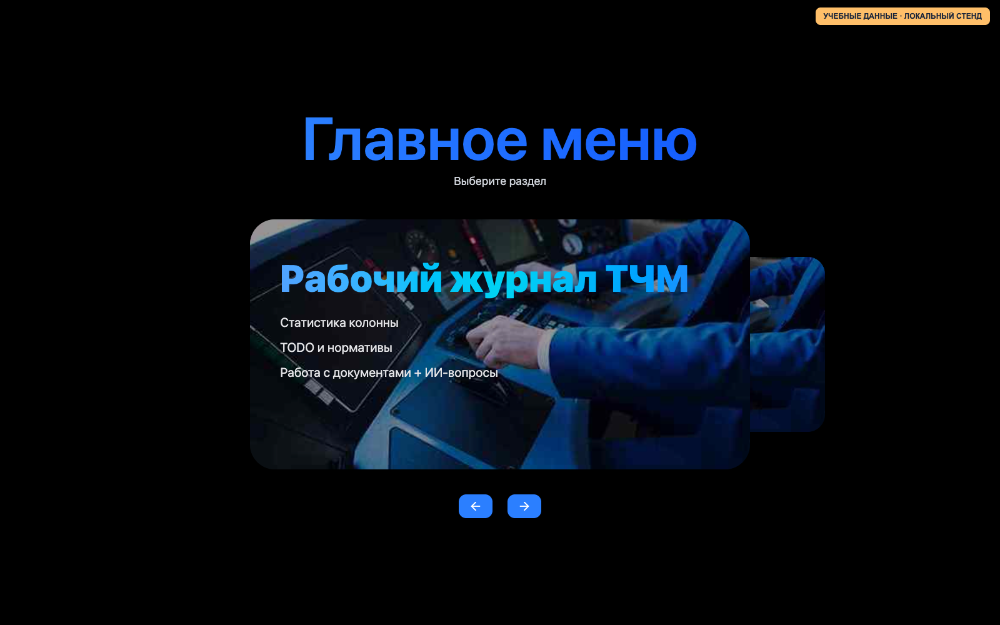
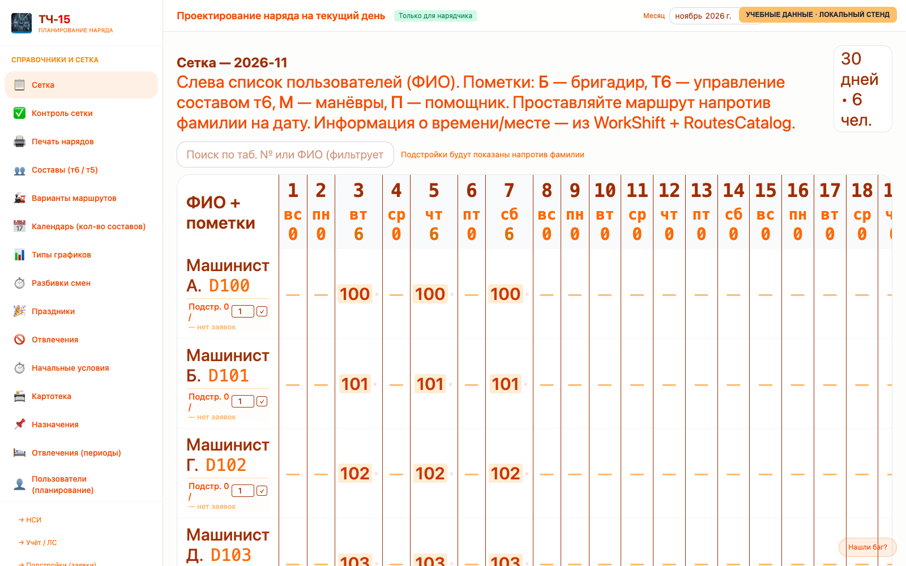
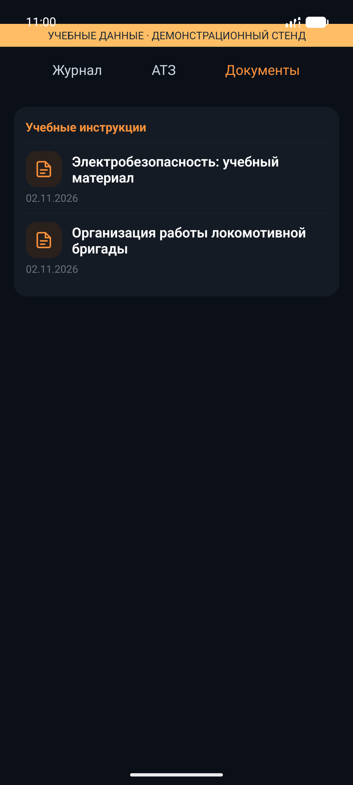

# АРМ ТЧ-15 — работа, учёт и обучение локомотивных бригад

Веб-приложение и Android-клиент для организации работы локомотивного депо. Проект объединяет рабочие процессы машинистов, инструкторов, нарядчиков и сотрудников учёта: от заявки на смену и выдачи наряда до обучения, ознакомления с документами и контроля выполнения задач.

**[Оглавление документации](docs/README.md)** · **[Архитектура](docs/architecture/ARCHITECTURE.md)** · **[Дизайн-документ](docs/management/ARM_DESIGN_DOCUMENT.md)** · **[Развёртывание](docs/operations/PRODUCTION_DEPLOYMENT.md)**

## Возможности

| Рабочее место | Основные сценарии |
| --- | --- |
| Машинист | Просмотр нарядов и расшифровки смен, подстройки, личный табель, периоды отсутствия, документы, обучение, тестирование и ознакомления |
| Инструктор | Журнал ТЧМ, контроль нормативов и сроков, задачи, планирование АТЗ, работа с колонной и поиск по выданным нарядам |
| Нарядчик | Сетка назначений, справочники и разбивки смен, контроль правил планирования, картотека, отвлечения, печать нарядов |
| Сотрудник учёта | Лицевые счета, отчёты, доплаты, выгрузки и закрытие месяца в модуле `/uchet` |
| Администратор | Управление пользователями, документами и обучением, роли, аналитика; отдельный доступ суперадминистратора к мобильному мониторингу |

Дополнительные функции: общий телефонный справочник, рабочий чат с вложениями, уведомления и привязка Telegram. Возможности ограничиваются ролью и правами пользователя.

Личный табель отделён от официального учёта: прогноз начислений является частичным, а периоды больничного, отпуска и учёбы учитываются без самостоятельного расчёта их оплаты. Статусы и ограничения конкретных выпусков приведены в документации.

## Интерфейс

Снимки реальных представлений веб-приложения и компонентов Android сняты на локальном демонстрационном стенде **с учебными данными**. Мобильные экраны показаны в демонстрационной оболочке; это иллюстрации интерфейса, а не подтверждение текущей production-версии. Подробности — в [описании съёмки](docs/management/presentation/README.md#условия-съёмки-и-достоверность).

### Главное меню



### Планирование нарядов



### Android: документы

<p align="center">
  
</p>

Больше экранов и сценариев: [презентация](docs/management/presentation/README.md) и [видеопрезентация](docs/management/video/README.md).

## Инженерная часть

- **Backend:** PHP 8.2+, Laravel 12, Filament 3; сессионная авторизация веба и Sanctum для мобильного API.
- **Веб:** Blade и React 19 islands, Vite, Tailwind; интерактивные компоненты подключаются к отдельным страницам.
- **Android:** React Native и Expo; серверный API, собственные экраны, просмотр документов и устойчивые очереди отдельных пользовательских операций.
- **Данные:** PostgreSQL для операционных данных, ClickHouse для аналитики, Redis для кеша и очередей, MinIO для файлов, Meilisearch для поиска.
- **Эксплуатация:** Docker Compose, Nginx/PHP-FPM, инструкции по защите, резервированию и закрытому мониторингу.

Сервер проверяет роли и принадлежность данных; новые файловые сценарии используют авторизованную выдачу через приложение без передачи клиентам ключей MinIO. Текущие меры и ограничения описаны в [разделе безопасности](docs/README.md#безопасность).

**Направления развития:** полный двусторонний обмен с локальным АРМ-НРД, шифрование идентифицирующих персональных полей с отдельным управлением ключами, безопасный CI/CD и локальный ИИ-помощник. Они не заявляются здесь как завершённые функции. MinIO сохраняется в текущей архитектуре.

Нагрузочные возможности оцениваются по измерениям, а не по числу зарегистрированных аккаунтов: [результаты проверки одновременной работы](docs/operations/capacity/2026-11-09/READINESS_500.md).

## Документация и разработка

Все тематические документы собраны в `docs/`. В [оглавлении](docs/README.md) есть разделы по модулям, мобильному приложению, безопасности, эксплуатации, развитию и выпускам. Правила работы с кодом: [AGENTS.md](AGENTS.md), [инструкции мобильного проекта](mobile/AGENTS.md).

### Локальный запуск

Потребуются Docker и Docker Compose. Выполнять в локальной среде, не на production:

```bash
cp .env.example .env
# Заполнить локальные настройки; не использовать production-секреты.
docker compose up -d --build
docker compose exec app php artisan key:generate
docker compose exec app php artisan migrate
npm ci
npm run build
```

Состав сервисов и переменные окружения сверять с `docker-compose.yaml` и `.env.example`. Для обновления production использовать [инструкцию развёртывания](docs/operations/PRODUCTION_DEPLOYMENT.md), а не команды локального запуска.

Мобильное приложение: [настройка и сборка](docs/mobile/README.md). Схема учёта АРМ-ЛБ: [описание](docs/architecture/armd.md) и [очередь переноса](docs/roadmap/armd-progress.md).

## Использование

Проект разрабатывается для внутренних рабочих процессов ТЧ-15.
