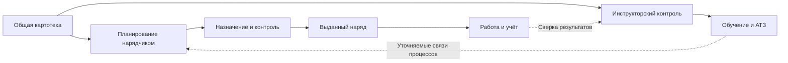
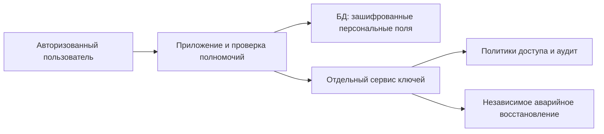

# ARM — единая среда организации работы, контроля и обучения локомотивных бригад

**Дизайн-документ для руководства и подготовки презентации**  
Версия 0.1 · 02 ноября 2026 года · Авторская рабочая редакция для согласования

Документ объединяет функциональное описание, архитектуру, меры защиты, открытые долги и развитие проекта. Он подготовлен по репозиторию и сохранённым отчётам; новая проверка production в рамках этой работы не выполнялась. Перед внешним представлением необходимо подтвердить бизнес-формулировки, актуальность эксплуатационных сведений и демонстрационные материалы.

## 1. Назначение и управленческая ценность

ARM создаётся как общая рабочая среда подразделения: от планирования работы локомотивных бригад до контроля исполнения, обучения и учёта. Веб-приложение обслуживает рабочие места специалистов, Android-приложение предоставляет сотрудникам доступ к разрешённым функциям с телефона. Доступ определяется ролью, активностью учётной записи, принадлежностью данных и, где применимо, колонной.

Общие кадровые данные связывают планирование, инструкторский журнал и учёт. Это создаёт основу для уменьшения повторного ввода, своевременного обнаружения конфликтов и прослеживаемости решений. Фактическая экономия времени, снижение числа ошибок и показатели использования должны измеряться при пользовательской проверке; численные обещания пока не установлены.

Проект уже имеет опубликованные веб- и Android-выпуски. Он одновременно остаётся развивающейся системой: полная сверка официальных расчётов, закрытый сетевой контур, шифрование персональных полей, автономный чат и интеллектуальный помощник требуют отдельных работ и приёмки.

| Участник | Основная задача в системе |
|---|---|
| Нарядчик | Планирование назначений, контроль сетки, справочники, формирование нарядов |
| Машинист | Получение разрешённых документов и нарядов, личный табель, обучение |
| Инструктор | Работа со своей колонной, нормативы, журнал, задачи и занятия АТЗ |
| Оператор учёта | Учётные карточки, лицевые счета, отчёты и бухгалтерская выгрузка |
| Руководитель | Поручения, проверка отчётов и контроль исполнения в пределах полномочий |
| Администратор | Учётные записи, роли, контент и эксплуатационные настройки |

Роли руководителя, инструктора и администратора не взаимозаменяемы: доступ к одному контуру не должен автоматически открывать все остальные.

## 2. Реализованные функциональные контуры

### 2.1. Рабочее место нарядчика и развитие АРМ-ЛБ

Это центральная часть проекта, связывающая организацию работы с контролем и последующим учётом. При подготовке учтён указанный владельцем комплект `ARMNRD/.migration`: копия приложения и материалы переноса картотеки. Указатель в каталоге ARMNRD относит актуальный код и дорожную карту клона к текущему репозиторию. Копия переноса не трактуется как независимое подтверждение полной эксплуатационной готовности.

В коде представлены месячная сетка назначений, бригады, календарь, разбивки смен, нормативы, картотека, назначения и отвлечения. При назначении действуют серверные правила PLANIR; отдельный контроль оценивает полноту сетки. Есть расчёт часов назначения, печать наряда и выписки, справочники НСИ, публикация и просмотр выданных нарядов. Это перенос значимых рабочих процессов исходной программы с добавлением разграничения доступа и проверок.

Учётный контур включает карточки, первичные и повторные лицевые счета, маршрутные листы, доплаты, архив учётных копий, закрытие/повторное открытие периода, отчёты и формирование бухгалтерских выгрузок. Схемы и формулы переноса документированы отдельно от личного табеля сотрудника.

**Граница готовности:** наличие этих функций в репозитории подтверждено маршрутами и сервисами, но дорожная карта сохраняет незавершённую сверку эталонного месяца. Полный паритет с FoxPro и приёмка выгрузки принимающей бухгалтерской системой не подтверждены. Их нельзя представлять как завершённые. Эксплуатационный статус каждого экрана нарядчика требует отдельной приёмки, не выводится из публикации Android.

Источники: [дорожная карта АРМ-ЛБ](../../armd-progress.md), [схемы и перенос](../../armd.md), `routes/naryad.php`, `routes/uchet.php`, сервисы Arm.

### 2.2. Общая картотека и взаимодействие сотрудников

Картотека служит общим кадровым источником. Отчёт переноса фиксирует импорт карточек с проверкой исходных полей и связью с существующими аккаунтами. Нарядчик и инструктор используют общие данные; инструктор ограничен своей колонной, оператору предоставлено чтение в предусмотренном контуре. Самостоятельное изменение личного профиля не даёт пользователю менять роль, активность и другие защищённые кадровые атрибуты.

Опубликован общий справочник телефонов для веба и Android. Нормализация номера и уникальность на уровне БД запрещают повторное внесение одного телефона под разными именами. В текущем выпуске пользовательское редактирование и удаление общего справочника не представлены как готовые возможности.

Источники: [картотека](../../PERSONNEL_IMPORT_2026-10-26.md), [профиль](../../ACCOUNTS_PROFILE_2026-10-26.md), [выпуск справочника](../../deployments/shared-phones-1.0.10.md).

### 2.3. Журнал инструктора, контроль и АТЗ

Журнал объединяет задачи, состав колонны, нормативы и отчётность. Проверка текущей роли и принадлежности данных выполняется на сервере. Мобильный журнал развивался от чтения сводки и нормативов до изменения собственных задач и работы с АТЗ.

Выпуск от 31 октября сообщает о публикации веба, API и Android 1.0.14 (код 15) с карточками АТЗ, выбором участников своей колонны, фактической явкой и отдельными периодами двух видов занятий. Планирование не считается выполнением. Подтверждённая явка фиксируется в истории и обновляет соответствующие нормативы; повторная отправка защищена идентификатором операции. Учтённые карточки защищены от обычного переписывания.

Ручная приёмка АТЗ реальным инструктором на физическом смартфоне в отчёте ещё не закрыта. Опубликованный функционал не обозначается полностью принятым только по результату автоматических тестов.

Источники: [АТЗ](../../INSTRUCTOR_ATZ.md), [отчёт выпуска](../../ATZ_RELEASE_2026-10-31.md), [мобильный журнал](../../mobile/JOURNAL.md), [личные задачи](../../mobile/JOURNAL_TASKS.md).

### 2.4. Исполнительская дисциплина

Руководитель выдаёт поручение выбранным исполнителям, инструктор направляет отчёт и приложения, проверяющий принимает результат либо возвращает на доработку с комментарием. История и условия задания сохраняются. Отправленный отчёт сам по себе не означает принятого исполнения.

Модуль опубликован; веб-панель показывает состояния, просрочки и поступившие отчёты. Внутренние уведомления записываются вместе с действием и не требуют Telegram для отображения в панели. Вложения приватны и проходят антивирусную проверку; при недоступности сканера публикация отчёта отклоняется.

Граница текущей модели — один экземпляр для подразделения: руководитель имеет предусмотренный доступ в пределах этого экземпляра, отдельная междеповская изоляция не реализована. Наличие истории не означает её защиты от администратора БД или криптографической неизменности.

Источник: [исполнительская дисциплина](../../DISCIPLINE.md), [мобильный клиент](../../mobile/DISCIPLINE.md).

### 2.5. Документы, обучение и проверка знаний

Система предоставляет документы и учебные материалы с проверкой разрешений, просмотром PDF и мультимедиа, комментариями и квизами. Выдача файлов документов и обучения проходит через приложение, а не через новые публичные ссылки на объектное хранилище. Ответы квизов проверяются сервером.

Предусмотрены веб- и мобильные маршруты, однако полное совпадение всех экранов и сценариев двух платформ не заявляется. Защита просмотра и фиксация нарушений уменьшают риск неконтролируемого распространения, но не гарантируют невозможность копирования информации с экрана.

Источники: [архитектура](../../ARCHITECTURE.md), [мобильный клиент](../../mobile/README.md), `routes/documents.php`, `routes/training.php`, `routes/api.php`. Ранние архитектурные описания применяются с учётом поздних исправлений доступа и файловой выдачи.

### 2.6. Личный учёт времени и предварительные начисления

Веб и Android используют общую серверную логику личного табеля. Учитываются смены, оплачиваемые перерывы, ночные/вечерние интервалы, связки ночных дежурств, отдых и помесячные настройки. Больничный, отпуск и учёба представлены периодами по датам, отдельно от отработанных часов; их оплата пока не рассчитывается.

Денежный результат — частичный ориентир, не окончательная зарплата к выплате. Он не заменяет официальный учёт и лицевые счета. Неподтверждённые начисления и удержания нельзя достраивать предположениями. Финансовые правила меняются только после согласования и проверки эталонных примеров.

Источники: [правила](../../WORK_TIME_RULES_PLAN.md), [серверная основа](../../PERSONAL_WORKTIME_BACKEND.md), [месячный расчёт](../../PERSONAL_WORKTIME_MONTH.md), [API](../../PERSONAL_WORKTIME_API.md), [интерфейс](../../PERSONAL_WORKTIME_UI.md), [опубликованные исправления](../../MOBILE_FIXES_2026-10-27.md).

### 2.7. Сквозной цикл и оставшиеся интеграции

Схема показывает организационный цикл и объединяемые контуры, а не подтверждение автоматического обмена на каждой стрелке. Прямой приём заявок на подстройки из внешнего приложения описан в TwoSideApi.md как требование развития. Доставка групповых заявок в arm-nrd также не подтверждена завершённой интеграцией. Этот разрыв включён в дорожную карту.

### 2.8. Возможности машиниста и отбор нарядов для инструктора

Дополнение к функциональному описанию от 02.11.2026: в презентации выделен отдельный путь машиниста — учёт смен и отдыха, заявки на подстройки, личный лист действий и записи в формуляр, аудио/видеоматериалы АТЗ, просмотр нарядов и личные файлы по пользователю. Подстройки подтверждены `PodstroikiController`, а лист действий и персональные отметки — `RospisiController`, `FormularTask` и `UserFormularLog`. Это не произвольный планировщик задач машиниста и не журнал задач инструктора. Подстройки и формуляр не объявляются доступными в Android только на основании веб-реализации.

Поиск инструктора (`NaryadSearchController`, `SearchEngine`, `ShiftCatalog`) принимает наряды, списки ФИО и разбивки смен. Он позволяет подготовить отбор по отдельным машинистам или списку своей колонны с расшифровкой при наличии разбивки. Автоматический выбор произвольной колонны из БД в этом сценарии не подтверждён. Упоминание «сортировки» в выступлении означает фактический отбор/разнесение по сотрудникам, не новую универсальную сортировку для всех ролей.

## 3. Внутренняя связь и развитие чата

По уточнению владельца обратная связь Backstage — текущая основа чата. В коде есть сохранение обращения и вложения с внешними уведомлениями. Двусторонний автономный обмен между сотрудниками ещё предстоит реализовать.

Целевой чат хранит сообщения и вложения в собственном контуре, проверяет доступ к диалогам и работает без обязательного участия Telegram, внешней почты или облачного push. На Android локальная сеть либо согласованный защищённый канал должны обеспечивать доступ к серверу. Отключение интернета не должно останавливать внутренний обмен; потеря связи с самим сервером должна отображаться явно.

Подтверждение серверного сохранения, доставки устройству и прочтения — разные состояния. Для устойчивости нужны повтор отправки без дублей, восстановление пропущенной истории, резервирование и испытания отказов. Показатели доступности и восстановления согласуются до обещаний надёжности. Источник: [план внутреннего чата](../../INTERNAL_CHAT_PLAN.md).

## 4. Архитектура и сетевая граница

Приложение использует Laravel и административные интерфейсы Filament; сложные пользовательские экраны реализованы отдельными React-компонентами. Мобильный клиент — самостоятельное Android-приложение Expo/React Native с серверным API. PostgreSQL хранит рабочие данные, ClickHouse — прикладную аналитику, MinIO — файлы, Redis — кеш и очереди, Meilisearch — поиск. Сервисы развёртываются Docker Compose.

### Текущее состояние по сохранённым проверкам

Отчёт сетевого аудита 29–30 октября сообщает, что прикладные БД и хранилища не имеют опубликованных портов хоста, а вход Docker ограничен точкой веб-доступа. Однако общий host firewall не был переведён в default-deny: INPUT ACCEPT, UFW не активирован. Система имела публичную веб-точку входа и внешние зависимости уведомлений. Это не полностью изолированная от интернета сеть.

### Целевая модель

Файервол должен ограничивать как входящие, так и необходимые исходящие связи. Выбор режима — решение владельца и организации: корпоративная сеть с контролируемым доступом либо разрешённый удалённый канал. Отдельно определить путь смартфонов, администрирование, обновления, DNS, резервирование, уведомления и сервер ключей. Сегментация сервисов должна ограничивать последствия компрометации одного компонента.

Файервол является самостоятельным слоем защиты. Он не заменяет авторизацию и шифрование, а закрытый периметр не устраняет внутреннего нарушителя или уязвимость разрешённого сервиса. Изменения границы применять с независимым резервным доступом, проверкой IPv4/IPv6 и возможностью отката.

Источник: [сетевой аудит](../../SERVER_NETWORK_AUDIT_2026-10-29.md). Новое сканирование и изменение настроек не входили в подготовку этого документа.

## 5. Защита ресурса и восстановление

| Слой | Подтверждённая основа | Пределы и дальнейшая проверка |
|---|---|---|
| Доступ приложения | Роли, активность, проверка владельца/колонны, авторизация API | Не все функции одинаковы на вебе и Android; проверки нужны для каждого сценария |
| Файлы | Частное хранилище, выдача через приложение, проверка вложений поручений | Не является абсолютным запретом копирования; старые исключения проверяются отдельно |
| Исполнение приложения | Read-only файловая система/код, ограниченные writable-каталоги, no-new-privileges | Скомпрометированный процесс сохраняет свои разрешённые права к рабочим данным |
| Секреты и БД | Разделение сервисных секретов, runtime-роль без административного DDL, ограниченные права хранилища | Административный доступ и рабочая расшифровка требуют отдельного контроля |
| Администрирование | SSH по ключам, Fail2Ban, отключение ненужного FTP и старого PHP | Не доказывает недоступность всех лишних сетевых служб |
| Аудит | Прикладные события и история действий | Не равнозначен независимому защищённому журналу инцидентов |
| Копии | Зашифрованный recovery-набор на компьютере владельца, проверка целостности, тест восстановления PostgreSQL | Автоматическое получение и полное восстановление приложения ещё не приняты |

Источники: [эксплуатационный регламент](../../SERVER_HARDENING_RUNBOOK.md), [отчёт укрепления](../../SERVER_HARDENING_PROGRESS_2026-10-28.md), [набор восстановления](../../FULL_BACKUP_2026-10-30.md), [план копий на ПК](../../PC_BACKUP_PLAN.md).

Копирование на компьютер — доступный сейчас независимый носитель за пределами production. Закрытый ключ расшифровки набора не передавался production. Это уже выполненная мера, но она не делает компьютер неизменяемым архивом и не гарантирует свежесть копии при выключенном ПК. Единственного носителя недостаточно для долгосрочной устойчивости; второй носитель остаётся потребностью при появлении ресурсов.

Набор включает БД, файлы, аналитику, код и закрытую конфигурацию в шифрованном виде. Проверка отдельного дампа не равна восстановлению всей системы. Копирование разных сервисов не является общей распределённой транзакцией: необходимо отдельно принять согласованность восстановления БД и объектов. RPO и RTO пока не зафиксированы измерениями полного восстановления.

Мониторинг следует развивать от наблюдения доступности, ошибок, свободного места, резервных копий и аномального доступа к проверенным реакциям. Автоматическое удаление или экстренное шифрование файлов по тревоге не предусмотрено: ложная тревога не должна уничтожать данные. Отзыв доступа и изоляция должны быть обратимыми и иметь регламент.

## 6. Шифрование идентифицирующих данных

**Статус: согласованное направление развития, не внедрённое шифрование рабочих полей.** Цель — ограничить последствия кражи дампа или отдельной базы. В охват входят ФИО, телефоны, даты рождения, номера прав управления и дополнительные идентификаторы после инвентаризации.

### Предлагаемая схема

1. Инвентаризировать поля и все копии: импортированные снимки, файлы нарядов, экспорты, поиск, журналы, уведомления, кеш и мобильные черновики.
2. Шифровать выбранные поля проверенным механизмом с контролем целостности и версией ключа. Ключи данных хранить в зашифрованном виде; главный ключ и управление им вынести из production в отдельный защищённый сервис.
3. Разделить право работы с данными, право управления ключами и аварийного восстановления. Размещение на сервере уведомлений допустимо только после отдельной оценки изоляции; скрытое имя файла не является защитой ключа.
4. Сохранить поиск и уникальность телефонов специальным защищённым индексом после нормализации. Поиск по части ФИО, сортировка и отчёты требуют отдельного решения; открытые копии в поисковом индексе сводят защиту на нет.
5. Выполнить пользовательскую проверку профиля на стенде, затем совместимую миграцию малыми партиями. Проверить ротацию, недоступность сервиса ключей, восстановление и задержки веба/Android.

Это целевая схема, не описание уже работающего сервиса ключей. Она не означает сквозного шифрования только на устройстве пользователя: приложение должно расшифровывать разрешённые сведения для работы. При захвате такого приложения злоумышленник может использовать его полномочия; внешний сервис ключей уменьшает риск кражи самих ключей и позволяет ограничивать/отзывать доступ, но не гарантирует секретность при любом взломе.

Пароли продолжают храниться стойкими хешами. TLS защищает передачу, шифрование backup — архив, шифрование полей — содержимое выбранных рабочих данных. Это разные меры. Табельный номер, email, расписание и связи между записями также могут идентифицировать человека; оставшиеся данные нельзя автоматически объявлять обезличенными.

Критерий приёмки: выбранные данные и учтённые копии не читаются из похищенного дампа без независимого доступа к ключам; поиск, роли, отчёты и восстановление продолжают работать. Источник: [план шифрования](../../PERSONAL_DATA_ENCRYPTION_PLAN.md).

## 7. Локальный интеллектуальный помощник

**Статус: проектное предложение.** Помощник должен работать на локальной машине внутри разрешённого контура, без передачи документов, запросов и ответов внешней модели. Модель, индекс, журналы и интерфейс размещаются под контролем организации. На первом этапе помощник отвечает по утверждённым инструкциям и показывает документ, редакцию и страницу-основание.

### Границы первого этапа

- Поиск и ответ только по доступным пользователю документам; проверка прав выполняется до включения текста в контекст модели.
- Отсутствие исходящего доступа процесса модели и обязательных облачных API/телеметрии; обновления моделей и библиотек проходят контролируемый перенос и проверку.
- Нет выполнения команд, самостоятельного изменения наряда, начислений или нормативов. Вывод модели — помощь специалисту, а не автоматическое распоряжение.
- При отсутствии подтверждённого источника помощник сообщает об ограничении, а не выдаёт предположение за установленное правило.
- Вредоносные инструкции внутри документов, устаревшие редакции и утечки через историю запросов входят в программу проверки.

Для пользовательской проверки нужны отобранный корпус инструкций, извлечение текста PDF/OCR, метаданные редакций и прав, локальный поиск и набор контрольных вопросов. Уже существующая работа с текстом документов не означает готовности полноценной модели.

Выбор модели, CPU/GPU, памяти и диска выполняется после оценки объёма корпуса, числа одновременных пользователей и допустимого времени ответа. Производительность и бюджет пока не определены. Сначала проводится пользовательская проверка на доступном компьютере, затем принимается решение о дополнительном оборудовании. Локальная модель сама по себе не создаёт сетевую изоляцию — её обеспечивают настройки размещения и доступа.

Критерии приёмки: работа при отключённом интернете, отсутствие неразрешённых сетевых обращений, запрет выдачи чужих документов, воспроизводимые ссылки на источники, согласованное качество на контрольных вопросах и измеренная задержка. Расширение до действий в системе потребует отдельного решения.

## 8. Сводная матрица готовности

«Опубликовано по отчёту» означает исторически зафиксированный выпуск, а не новую проверку сервера сегодня. «В коде» не означает эксплуатационную приёмку. Целевые возможности не включены в перечень действующих гарантий.

| Контур | Код / проверки | Эксплуатационный статус по источникам | Открытый результат |
|---|---|---|---|
| Нарядчик, НСИ, официальный учёт | Реализованы сервисы и маршруты, есть проверки | Полная приёмка контура не подтверждена единым актуальным отчётом | Эталонный месяц, живой сценарий нарядчика, приёмка выгрузки |
| Картотека и профиль | Реализованы, отчёт импорта и тестов | Опубликовано по отчётам 26–27 октября | Проверка актуальности состава и распределения колонн |
| Телефонный справочник | Общая БД, нормализация и уникальность | Опубликовано по отчёту 26 октября | Управление исправлениями/удалениями |
| Поручения | Веб и мобильный клиент, проверки ролей и повторов | Опубликовано по отчётам 23–24 октября | Приёмка под фактическими руководителями, дополнительные сценарии отказов |
| Журнал и личные задачи | Общие сервисы веба/API, проверки владения | Опубликовано по отчётам 25–27 октября | Полное сравнение функций двух платформ |
| АТЗ | Карточки, учёт и периоды; целевые тесты успешны | Веб/API и Android 1.0.14 опубликованы 31 октября | Приёмка на физическом смартфоне и интеграция arm-nrd |
| Личный табель | Общий расчёт, периоды отсутствия, устойчивые операции | Опубликовано по отчётам 27–28 октября | Полнота оплаты; это не окончательная зарплата |
| Документы и обучение | Веб/API, серверные проверки и файловый прокси | Действующий функциональный контур; старые описания требуют сверки по сценариям | Матрица паритета и приёмка на устройствах |
| Read-only runtime и права сервисов | Проверены в отчётах укрепления и выпуска | Применено по отчётам 28–31 октября | Повторная эксплуатационная проверка при изменениях |
| Backup | Recovery-набор принят на ПК, отдельный PG restore проверен | Ручной процесс; расписание не включено | Полное восстановление, автоматизация, второй носитель |
| Firewall и закрытая сеть | Частичные сетевые ограничения описаны аудитом | Полная изоляция не подтверждена | Утверждение границ и отдельное внедрение default-deny |
| Шифрование персональных полей | Архитектура согласована как направление | Не внедрено | Стенд ключей, пользовательская проверка, миграция и приёмка |
| Чат | Backstage как основа | Автономный внутренний чат не опубликован | Диалоги, доставка, права, отказоустойчивость |
| Локальный помощник | Предлагается в этом документе | Не внедрён | Корпус, стенд, измерение качества и оборудования |
| CI/CD | План записан | Workflow и автоматическая выкладка не включены | CI без доступа к production, затем управляемый выпуск |

В отчёте последнего выпуска успешны 108 целевых PHP-тестов и 41 мобильный тест. Там же сохранены 15 failures и 1 error полного набора в старом учёте, воспроизведённые на исходной версии. Эти результаты не являются новым прогоном от 2 ноября; полный набор нельзя называть успешным.

## 9. Долги и порядок развития

Ниже — объединённые направления, а не замена всех подробных критериев исходных планов. Предложенные приоритеты требуют утверждения владельцем. Ответственные пока обозначены ролями; персональные назначения и сроки не согласованы.

| Приоритет | Работа и риск | Зависимость / критерий завершения | Предлагаемая ответственность |
|---|---|---|---|
| 1 | Сетевая граница и доступ к секретам | Согласованные разрешённые связи, независимый вход и проверенный откат; повторная проверка периметра | Администратор инфраструктуры + владелец |
| 1 | Восстановление и свежесть копий | Полное восстановление приложения из копии на ПК; измеренные RPO/RTO, затем ограниченное расписание | Инфраструктура + владелец носителя |
| 1 | Приёмка действующих сценариев | Проверки на физическом Android и вебе под реальными ролями на демонстрационных данных | Тестировщик + представители подразделения |
| 1 | Ошибки учёта и эталонный месяц | Разбор существующих сбоев, сравнение строк/часов/сумм и приёмка бухгалтерской выгрузки | Разработчик + нарядчик/оператор |
| 2 | Шифрование идентифицирующих данных | Карта всех копий, отдельный сервис ключей, восстановление, поиск и поэтапная миграция | Разработка + инфраструктура + владелец |
| 2 | CI без доступа к production | Воспроизводимые тесты/сборки; известные ошибки не скрыты; затем отдельная защищённая доставка | Разработчик |
| 2 | Интеграция заявок и сквозной цикл | Контракт, полномочия, лимиты, повторы и фактическая доставка в контур нарядчика | Разработчик + нарядчик/инструктор |
| 2 | Внутренний чат | Обмен без внешних сервисов, испытания повторов и восстановления | Разработка + тестировщик |
| 3 | Локальный помощник | Подготовленный корпус, права, отсутствие внешних обращений, измеренное качество и нагрузка | Разработка + эксперт по инструкциям |
| Постоянно | Сопровождение и остальные долги | Зависимости, e2e административных загрузок, ограничения поиска/нагрузки, токены, исключения доступа, обновление документации | Разработка + эксплуатация |

Сохранить отдельные решения по месячному барьеру/двум устройствам, оставшимся файловым URL и настройкам Filament, полноте мобильных разделов, ограничениям iOS, обслуживанию хранилища и мониторингу. Старые записи об их состоянии сверяются с кодом и последними выпусками перед реализацией. Платёжный функционал и способы финансирования остаются отдельным от эксплуатационной готовности вопросом; наличие кода оплаты не означает настроенный приём платежей.

Массовая смена технологий и переписывание канонической карусели не являются необходимыми условиями этих этапов. Расчёты, доступ и аналитика изменяются отдельными проверяемыми пакетами с требуемым согласованием.

CI/CD внедряется последовательно: автоматические тесты и сборки без производственных секретов → проверяемые артефакты → публикация после подтверждения. Runner на production, произвольный sudo и изменяемые из репозитория root-скрипты не допускаются проектным планом. Источник: [CI/CD](../../CI_CD_PLAN.md).

## 10. Решения руководства и оценка результата

Для развития необходимо согласовать владельца продукта, ответственных за данные и эксплуатацию, состав группы пользователей, режим сетевого доступа и допустимые внешние связи. Для шифрования — правила доступа к ключам и аварийного восстановления; для помощника — корпус инструкций и критерии корректного ответа; для чата — участников, хранение и показатели доставки.

Бюджет оборудования, резервного носителя и сопровождения оценивается после инвентаризации нагрузки и измерений при пользовательской проверке. Конкретные суммы и сроки в текущей редакции не утверждены.

| Показатель | Как получить исходное значение и принять результат |
|---|---|
| Время подготовки наряда | Сравнить одинаковые сценарии при пользовательской проверке, учитывать исправления и число назначений |
| Конфликты планирования | Считать обнаруженные и подтверждённые нарушения, отдельно ложные блокировки |
| Контроль и обучение | Доля своевременно выполненных нормативов по согласованному определению; не подменять заполненностью дат |
| Поручения | Время от выдачи до принятия, доля просрочек и возвратов |
| Восстановление | Реально измеренные потеря данных по времени и длительность полного восстановления |
| Помощник | Корректность и полнота ссылок, доля обоснованных отказов, запрет чужих данных, задержка |
| Чат | Подтверждённая доставка и восстановление истории при заданных отказах |

## 11. Сценарий презентации и подготовка экранов

Основная редакция расширена до 18 слайдов; техническая сохранена отдельно на 20 слайдах. Включены темы: задача подразделения; единый цикл; рабочее место нарядчика; рабочий день машиниста; журнал/АТЗ; поручения и обучение; архитектура; действующая защита; резервирование; план шифрования; чат; локальный помощник; дорожная карта; решения руководства. Для короткого выступления смежные темы можно объединить.

| Экран / схема | Что показать | Что ещё требуется |
|---|---|---|
| Главная карусель веба + Android | Единый вход и роль пользователя | Демонстрационные данные, фактическая версия |
| Сетка нарядчика и контроль | Планирование и понятная причина ограничения | Подготовленный пример без реальных фамилий |
| Выданный наряд и мобильный просмотр | Доведение задания сотруднику | Синтетический PDF/наряд |
| Личный табель | Часы, отдых и периоды отсутствия | Подпись «частичный расчёт», не зарплата к выплате |
| Журнал и занятие АТЗ | План → явка → норматив | Учебная колонна и проверенные сценарии |
| Поручение и приёмка отчёта | Контроль исполнения с историей | Демонстрационные исполнители/вложения |
| Документ и квиз | Обучение с источником | Разрешённый для показа материал |
| Сеть и защита | Текущая граница отдельно от целевой | Схема без адресов, ключей и административных реквизитов |
| Backup и шифрование | Различие действующих копий и будущих полей | Явные подписи статусов |
| Чат и помощник | Следующее развитие | Пока схемы/концепции; не выдавать за действующие экраны |

Этап 3 от 02.11.2026: подготовлены [презентация и условия съёмки](presentation/README.md), 9 учебных снимков веба/Android, основная презентация на 18 слайдов и техническая на 20 слайдов в PowerPoint, HTML и PDF. Веб-представления сняты на временной базе; Android-компоненты — в отдельной оболочке с локальными ответами API. Это не приёмка на физическом телефоне. Полная штатная навигация Android и все перечисленные выше экраны в текущую съёмку не вошли. Макеты будущих функций не выдаются за действующие экраны. Production-записи, реальные персональные данные и секреты для презентации не использовались.

## 12. Основания, противоречия и сопровождение документа

Единый текст является редакционной сводкой исходников, а не их механической склейкой. [Реестр источников](SOURCE_INVENTORY.md) сохраняет полный список обнаруженных материалов и сравнение внешнего комплекта. Основные расхождения разрешены следующим образом:

| Раннее описание | Уточнение в этой редакции |
|---|---|
| В мобильном приложении нет журнала/учёта | Поздние выпуски добавили журнал, задачи, личный табель и АТЗ; полный паритет не заявляется |
| Backup не описан | Есть отчёты и принятый recovery-набор на ПК; автоматизация и полный restore остаются открытыми |
| Права сервисов/read-only ещё в очереди | Поздние отчёты фиксируют применение; старые строки плана не используются как текущий статус |
| В документации развёртывания есть команды UFW | Инструкция не доказывает применение; фактический сетевой аудит не подтверждает включённый UFW |
| Android указан как 1.0.13 | Последний рассмотренный отчёт выпуска фиксирует 1.0.14 (15) от 31 октября |
| Обратная связь называется чатом | По уточнению владельца это начальный этап; автономный чат включён в развитие |
| Предлагается шифрование | Зашифрованные backup уже есть; шифрование персональных полей ещё не внедрено |
| Модули охватывают полный цикл | Организационный охват есть; некоторые интеграционные границы и официальные расчёты ещё требуют приёмки |

Полное содержимое исторических инструкций и контрольные суммы оставлены в исходных документах. Они могут содержать чувствительные эксплуатационные сведения; перед передачей руководству распространять именно согласованный сводный текст, а не автоматически весь каталог исходников. Все источники из инвентаризации остаются трассируемыми через приложение ниже.

### Точка продолжения

Этапы 2–3: подготовлены первая сводная редакция, матрица статусов, учебные снимки и презентация. Следующий этап — просмотр владельцем, согласование формулировок/приоритетов и финальная редактура, включая проверку PPTX в целевом приложении. Изменения функций, настроек сервера, шифрования и модели этой документальной работой не выполнялись.

## 13. Карта источников и охват инвентаризации

Навигационное приложение включает все источники исходной инвентаризации и новый план чата. Перечень сохраняет трассируемость, но исторические инструкции не отменяют поздние отчёты выпусков. Контрольные суммы и сравнение внешней копии — в SOURCE_INVENTORY.md. Группировка указывает основные разделы использования; ранние исправления, планы оплаты и инструкции сборки сохраняются как история и ограничения, а не как новые обещания.

### Архитектура и функциональные планы — разделы 1–3, 7–10

- [ACCOUNTS_PROFILE_2026-10-26.md](../../ACCOUNTS_PROFILE_2026-10-26.md)
- [AGENTS.md](../../AGENTS.md)
- [ARCHITECTURE.md](../../ARCHITECTURE.md)
- [DISCIPLINE.md](../../DISCIPLINE.md)
- [INTERNAL_CHAT_PLAN.md](../../INTERNAL_CHAT_PLAN.md)
- [MOBILE_FIXES_2026-10-27.md](../../MOBILE_FIXES_2026-10-27.md)
- [MOBILE_WEB_PARITY_PLAN.md](../../MOBILE_WEB_PARITY_PLAN.md)
- [PAYMENT_OPTIONS.md](../../PAYMENT_OPTIONS.md)
- [PHONE_DIRECTORY_PLAN.md](../../PHONE_DIRECTORY_PLAN.md)
- [PROFILE_RECOVERY_PLAN.md](../../PROFILE_RECOVERY_PLAN.md)
- [README.md](../../README.md)
- [TECHNICAL_DEBT.md](../../TECHNICAL_DEBT.md)
- [TELEGRAM_SETUP.md](../../TELEGRAM_SETUP.md)

### Защита и восстановление — разделы 4–6, 9

- [APK_SECURITY_AUDIT_2026-10-24.md](../../APK_SECURITY_AUDIT_2026-10-24.md)
- [BACKUP_AUDIT_2026-10-30.md](../../BACKUP_AUDIT_2026-10-30.md)
- [BACKUP_STORAGE_OPTIONS.md](../../BACKUP_STORAGE_OPTIONS.md)
- [CLICKHOUSE_STORAGE_AUDIT_2026-10-28.md](../../CLICKHOUSE_STORAGE_AUDIT_2026-10-28.md)
- [FULL_BACKUP_2026-10-30.md](../../FULL_BACKUP_2026-10-30.md)
- [PC_BACKUP_PLAN.md](../../PC_BACKUP_PLAN.md)
- [PERSONAL_DATA_ENCRYPTION_PLAN.md](../../PERSONAL_DATA_ENCRYPTION_PLAN.md)
- [SECURITY_CHECKPOINT_2026-10-28.md](../../SECURITY_CHECKPOINT_2026-10-28.md)
- [SECURITY_DEPENDENCIES.md](../../SECURITY_DEPENDENCIES.md)
- [SECURITY_ROADMAP.md](../../SECURITY_ROADMAP.md)
- [SERVER_HARDENING_PROGRESS_2026-10-28.md](../../SERVER_HARDENING_PROGRESS_2026-10-28.md)
- [SERVER_HARDENING_RUNBOOK.md](../../SERVER_HARDENING_RUNBOOK.md)
- [SERVER_NETWORK_AUDIT_2026-10-29.md](../../SERVER_NETWORK_AUDIT_2026-10-29.md)
- [SERVER_SECURITY_AUDIT_2026-10-28.md](../../SERVER_SECURITY_AUDIT_2026-10-28.md)

### Выпуски и эксплуатация — разделы 5, 8–9

- [ATZ_RELEASE_2026-10-31.md](../../ATZ_RELEASE_2026-10-31.md)
- [CI_CD_PLAN.md](../../CI_CD_PLAN.md)
- [DEPLOYMENT.md](../../DEPLOYMENT.md)
- [DEPLOY_SUMMARY.md](../../DEPLOY_SUMMARY.md)
- [PRODUCTION_DEPLOYMENT.md](../../PRODUCTION_DEPLOYMENT.md)
- [RELEASE_2026-10-27.md](../../RELEASE_2026-10-27.md)
- [RELEASE_RECOVERY_2026-10-24.md](../../RELEASE_RECOVERY_2026-10-24.md)
- [deployments/2026-10-23-discipline.md](../../deployments/2026-10-23-discipline.md)
- [deployments/2026-10-24-mobile-discipline.md](../../deployments/2026-10-24-mobile-discipline.md)
- [deployments/2026-10-25-mobile-journal.md](../../deployments/2026-10-25-mobile-journal.md)
- [deployments/mobile-profile-icons-1.0.9.md](../../deployments/mobile-profile-icons-1.0.9.md)
- [deployments/shared-phones-1.0.10.md](../../deployments/shared-phones-1.0.10.md)

### Планирование, картотека и АТЗ — разделы 2.1–2.3, 2.7

- [INSTRUCTOR_ATZ.md](../../INSTRUCTOR_ATZ.md)
- [PERSONNEL_IMPORT_2026-10-26.md](../../PERSONNEL_IMPORT_2026-10-26.md)
- [TwoSideApi.md](../../TwoSideApi.md)
- [armd-progress.md](../../armd-progress.md)
- [armd.md](../../armd.md)

### Рабочее время и расчёты — разделы 2.6, 8–9

- [PERSONAL_WORKTIME_API.md](../../PERSONAL_WORKTIME_API.md)
- [PERSONAL_WORKTIME_BACKEND.md](../../PERSONAL_WORKTIME_BACKEND.md)
- [PERSONAL_WORKTIME_MONTH.md](../../PERSONAL_WORKTIME_MONTH.md)
- [PERSONAL_WORKTIME_UI.md](../../PERSONAL_WORKTIME_UI.md)
- [WORK_TIME_RULES_COMPARISON.md](../../WORK_TIME_RULES_COMPARISON.md)
- [WORK_TIME_RULES_PLAN.md](../../WORK_TIME_RULES_PLAN.md)
- [timemanagment.md](../../timemanagment.md)

### Мобильное приложение — разделы 2, 8, 11

- [mobile/AGENTS.md](../../mobile/AGENTS.md)
- [mobile/ANDROID_CRASH_FIX.md](../../mobile/ANDROID_CRASH_FIX.md)
- [mobile/CLAUDE.md](../../mobile/CLAUDE.md)
- [mobile/DISCIPLINE.md](../../mobile/DISCIPLINE.md)
- [mobile/ICONS.md](../../mobile/ICONS.md)
- [mobile/JOURNAL.md](../../mobile/JOURNAL.md)
- [mobile/JOURNAL_TASKS.md](../../mobile/JOURNAL_TASKS.md)
- [mobile/LOGIN_FIX.md](../../mobile/LOGIN_FIX.md)
- [mobile/README.md](../../mobile/README.md)
