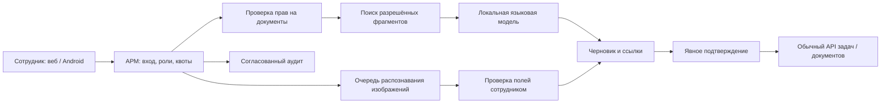

# Локальный ИИ для АРМ: ресурсы и этапы

Инженерная концепция от 10.11.2026. Это обоснование демонстрации и план, не внедрение модели в production. Все аппаратные профили и сроки ниже — наши проектные оценки, а не результаты испытаний. Производственные настройки, новые события аналитики и изменения прав здесь не выполняются.

## Первый полезный результат

1. Сотрудник входит в АРМ и задаёт вопрос по утверждённым материалам.
2. Сервер проверяет права, выбирает разрешённые фрагменты и передаёт их локальной модели.
3. Ответ показывает источник, редакцию и страницу; при недостатке оснований — отказ/запрос уточнения.
4. Для фотографии рукописи предлагаются текст и структурированные поля. Нечитаемые места отмечаются; данные не подставляются догадкой.
5. На основе подтверждённого текста готовятся черновик документа и предложение задач. Уполномоченный сотрудник подтверждает запись через обычный API АРМ.

На первом этапе помощник не будет управлять безопасностью движения, менять назначения, нормативы или зарплату, исполнять shell/SQL или создавать подпись от имени сотрудника.

## Архитектура и интерфейс

Веб-терминал помощника — новый интерфейс на существующей авторизации ARM, а не SSH-терминал. Первый вариант может быть React island: диалог, список источников, вложения, просмотр рукописи рядом с распознанными полями, история и кнопка подтверждения. Для Android — отдельный экран того же серверного API. Состояния: очередь, обработка, нужен ввод, черновик, подтверждено, ошибка. Нужны отмена запроса, доступная навигация и сохранение разрешённых черновиков без утечки между пользователями.

МинIO, его конфигурация и текущие данные сохраняются без изменений. Новое решение читает разрешённые материалы через существующий серверный контур; индекс и модель не дают обходного доступа к общему бакету. Выбор нового индекса/расширения БД — отдельное решение, не обязательная установка в текущую PostgreSQL.

## Аппаратные профили для испытаний

| Профиль | CPU / RAM | GPU | Диски | Что проверять |
| --- | --- | --- | --- | --- |
| Текстовая демонстрация | 8–12 CPU-ядер; RAM 32 ГБ | Допускается CPU-only | NVMe от 1 ТБ с запасом | Небольшая модель порядка 4–8B в квантованном формате; один выполняемый запрос; приемлемость задержки |
| Проект с изображениями | 12–16 CPU-ядер; RAM 64 ГБ | Ориентир 24 ГБ VRAM | NVMe от 1 ТБ плюс рассчитанные документы, индексы, staging и независимые копии | Текстовая/визуальная модели последовательно или с проверенным бюджетом памяти; ограничения очереди |
| Расширение | 16–32 CPU-ядер; RAM 128 ГБ | Ориентир 48 ГБ VRAM и выше либо независимые GPU-работники | Отдельный расчёт роста и IOPS | Более крупные модели, длинный контекст и параллельность только после измерений |
| Дообучение | Отдельный стенд; RAM 64–128 ГБ как начальный бюджет | 24–48 ГБ и выше для небольших адаптеров по подходящим настройкам; сложные vision-задачи могут потребовать 48–80 ГБ и больше | Место под наборы, контрольные точки и несколько версий | Реальное потребление зависит от модели, изображений, длины, batch и оптимизатора; подбор до покупки |

VRAM и RAM — разные бюджеты. Несколько карт по 24 ГБ не превращаются автоматически в одну карту 48 ГБ: для разделения модели нужны подходящее ПО и связность; альтернатива — независимые очереди. У Apple Silicon память объединённая, поэтому такие цифры нельзя переносить на Mac как на систему с отдельной VRAM.

Нижняя арифметическая оценка только весов 8B при 4 битах — около 4 ГБ в десятичном исчислении. Реальное потребление выше из-за служебных данных, KV-cache, изображений, буферов и контекста. Поэтому размер файла модели не является минимумом памяти сервера.

Модели-кандидаты для сравнения, а не окончательный выбор: текстовая Qwen3 небольшого размера и vision-модель семейства Qwen2.5-VL. Это проверяемые открытые примеры, не утверждение, что они последние или лучшие. Лицензии, фиксированные ревизии, совместимость GPU/драйверов и проверенные форматы подбираются перед развёртыванием. Применимость к русской рукописи и отраслевым сокращениям проверяется отдельно.

В проекте начать с одного выполняемого задания и очереди; повышать параллелизм после проверки. Зарегистрированные сотрудники не равны одновременно генерируемым ответам. Число поддерживаемых пользователей и токенов в секунду пока не измерено. 500 одновременных ответов не обещаются.

Существующий production ARM не используется как свободный вычислительный стенд. GPU-сервис лучше вынести на отдельный узел в разрешённой сети. Отказ помощника не должен блокировать вход, наряды, документы и основной рабочий процесс.

## Развёртывание и защита

- Изолированный inference/OCR-сервис без публичного порта; TLS и авторизация через ARM, межсервисные полномочия с минимальными правами. VPN/локальная сеть и firewall определяются схемой внедрения.
- Исходящие соединения процесса модели запрещены; отключена телеметрия, нет обязательной облачной модели. Изоляция проверяется сетевыми тестами, а не только настройкой «local».
- Модели, зависимости и драйверы импортируются по контролируемому процессу: источники, лицензии, хеши, ревизии, проверка содержимого и испытания перед обновлением. Не включать выполнение удалённого кода из model repository автоматически.
- Авторизация до поиска и повторная проверка при выдаче исходника. Фильтрация прав применяется к индексам, ссылкам, кешу и истории беседы. Чужой документ не должен попасть в контекст даже по прямому ID или ссылке.
- Документ и вывод модели считаются недоверенными. Инструкции из документа не становятся системными командами. Ссылки модели проверяются, HTML очищается, произвольные URL и пути не загружаются.
- Вложения ограничиваются типом, размером и числом страниц, проходят проверку; OCR/парсеры работают в ограниченном процессе с таймаутами и ресурсными лимитами.
- Инструменты модели — только явный разрешённый набор. Запись в рабочие данные через существующий API после подтверждения; повтор не создаёт дубликат. Прямой доступ модели к БД, shell и Docker socket отсутствует.
- Секреты не включаются в prompts, журналы и учебные наборы. Уязвимость хоста всё ещё опасна: локальная модель не гарантирует защиты от компрометации сервера.
- Отдельный административный SSH-доступ по ключам, согласованные MFA/сетевая область и журнал администрирования. Обычный пользователь помощника не получает SSH.

## Журналирование и данные

Для будущего согласования: вход в интерфейс, разрешённый/запрещённый запрос, версия модели/шаблона, ID разрешённых источников, результат обработки, подтверждение/отмена действия, ошибка и длительность. По умолчанию — без полного текста запроса/ответа, изображений, паролей и токенов.

Серверная интеграция использует ClickHouseService и очередь analytics по правилам проекта. Конкретные новые типы событий и поля требуют отдельного согласования; этим документом они не добавлены. Доступ к аудиту ограничен; IP/идентификаторы устройств также учитываются как чувствительные метаданные.

Текущая очистка событий и политика хранения AI-диалогов/образцов — разные вопросы. Сроки диалогов, временных изображений, индексов, результатов и учебного корпуса согласуются отдельно. Минимизировать содержимое, предусмотреть удаление и независимые копии. Полные запросы не записывать под видом «безопасной статистики».

## Распознавание, обучение и подготовка корпуса

| Метод | Что меняется | Для чего |
| --- | --- | --- |
| RAG / индекс | Поисковый корпус и разрешённые фрагменты | Новые инструкции, редакции и источники без изменения весов |
| Шаблоны и несколько примеров | Правила запроса, структура ожидаемого результата | Единообразные черновики и выделение полей |
| Дообучение адаптера LoRA/QLoRA | Часть обучаемых параметров/адаптер | Проверенный пробел в стиле, формате или целевом распознавании |
| Обучение с нуля | Вся модель и большая инфраструктура | Не входит в первый этап и не требуется для демонстрации |

Рукопись: сначала типовые бланки, качественные фото и ручная расшифровка; затем исправления, зачёркивания, разные авторы, освещение и термины. На первый демонстрационный сценарий можно подготовить 20–50 разрешённых образцов; для настройки и проверки расширять корпус, например до нескольких сотен страниц. Это бюджет разметки, не гарантия достаточности.

Разделять обучающие и контрольные примеры по авторам и документам, чтобы копии одного листа и один почерк не создавали ложный результат. Правильную расшифровку проверяет эксперт. Наборы минимизируются/обезличиваются там, где это не разрушает задачу; происхождение и право использования документируются. Исправление пользователем не является автоматическим разрешением включить данные в обучение.

Для задач и черновиков проверять адресата, срок, обязательные поля, основания и отсутствие придуманных фактов. Отдельно проверять отказ при нечитаемом тексте, отсутствие утечки и запрет выполнения скрытых инструкций. Веса и адаптеры версионировать; сравнивать с базовой моделью, предусмотреть откат. Обучение не гарантирует, что модель перестанет ошибаться.

## Этапы проекта и условия сроков

Отсчёт от готовности доступного стенда, разрешённого корпуса, согласованных сценариев и участия ответственного эксперта. Ориентир — один разработчик на основной занятости, эксперт подразделения несколько часов в неделю и администратор на подготовку/проверки. Параллельная работа над другими задачами увеличивает календарные сроки.

| Окно | Демонстрационный результат | Критерий |
| --- | --- | --- |
| 1–2 недели | Вход и ответ по небольшому корпусу | Ссылки на разрешённые источники, корректный отказ, контроль чужого доступа |
| 2–4 недели | Разбор разрешённых рукописей и черновики | Поля рядом с изображением, видимые сомнения, исправление и подтверждение |
| 4–6 недель | Предложения поручений и интеграция | Запись только после подтверждения, права, дедупликация и аудит |
| 6–10 недель | Запуск проекта для первой группы | Измеренные качество/нагрузка, мониторинг, восстановление и откат |
| Дополнительно, если нужно | Эксперимент с адаптером | После оценки пробелов и подготовки корпуса; отдельная оценка порядка 4–8 недель и более |

Это не обещание рабочего промышленного OCR к определённой дате. Необходимость разметки, закупки, дообучения, согласования безопасности и исправления качества меняет план. Сначала утверждается узкий сценарий, затем объём расширяется.

## Стоимость и сопровождение

Бюджет: оборудование + сеть/питание/охлаждение/ИБП + независимые копии + подготовка корпуса + разработка/экспертная проверка + обновления и реагирование. Цены на GPU и аренду не фиксируются без выбора модели и актуальных предложений. Работа в изолированной сети не отменяет обновление и обслуживание.

Потребление и тепловыделение брать из паспорта выбранной системы и измерений. Стоимость электричества рассчитывать как фактические кВт × часы × местный тариф. Учитывать место для восстановления, проверку копий, отказ узла и доступность замены. Ресурсы дообучения не должны отнимать мощность обслуживающего пользователей inference.

## Источники

Официальные материалы проверены 10.11.2026; для аппаратных профилей и сроков выше приведены собственные оценки.

- [Qwen3: описание семейства](https://qwenlm.github.io/blog/qwen3/) и [карточка Qwen3-8B](https://huggingface.co/Qwen/Qwen3-8B): пример открытой текстовой модели, состав и способы запуска. Не использованы как готовый benchmark оборудования ARM.
- [Qwen2.5-VL](https://qwenlm.github.io/blog/qwen2.5-vl/): модель работы с изображениями и документами, в том числе рукописями. Это не доказательство точности на русских производственных рапортах.
- [PEFT / LoRA](https://huggingface.co/docs/peft/main/en/conceptual_guides/lora): адаптерный подход к дообучению; конкретная конфигурация памяти требует испытаний.
- [vLLM: безопасность](https://docs.vllm.ai/en/stable/usage/security/): ограничения встроенного API-key и необходимость сетевой защиты. Один ключ inference-сервиса не заменяет пользовательскую авторизацию ARM; не все служебные endpoints защищены им одинаково.

[Назад к комплекту презентации](README.md).
